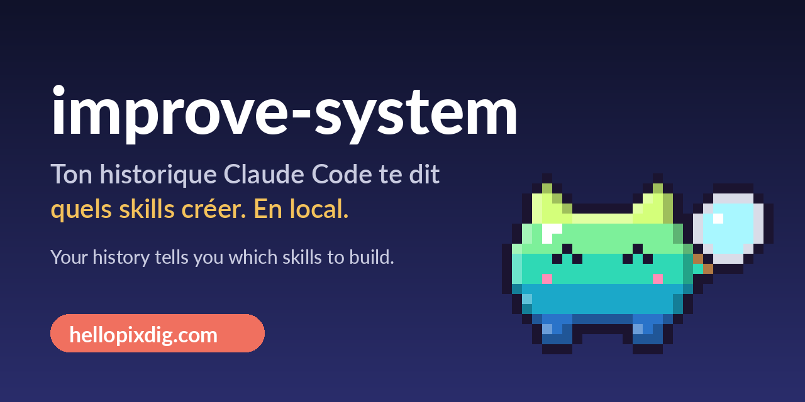

<p align="center"></p>

<p align="center">
  <a href="#français">Français</a> · <a href="#english">English</a> ·
  <a href="https://hellopixdig.com">hellopixdig.com</a> · <a href="https://www.instagram.com/hellopixdig">Instagram</a>
</p>

---

## Français

**Claude relit ce que tu lui demandes, et écrit les skills qui te manquent.**

Tu refais les mêmes demandes de session en session sans t'en rendre compte. `improve-system` lit ton historique Claude Code **en local**, repère ce qui revient, et te propose (puis crée, après ton accord) les skills qui t'éviteront de le refaire.

- 🔁 **Les tâches répétées** : ce que tu redemandes dans plusieurs sessions différentes
- ✋ **Les corrections qui reviennent** : « refais », « c'est pas ça »… ce que Claude n'a pas retenu
- 🗣️ **Tes aveux** : « je le fais toujours à la main »
- 🛠️ **Les skills proposés** : écrits dans `~/.claude/skills/` seulement si tu es d'accord

🔒 **100 % local** : Python 3 standard, aucune dépendance, aucun appel réseau, rien n'est envoyé.

### Installer (30 secondes)
```bash
git clone https://github.com/HelloPixDig/improve-system ~/.claude/skills/improve-system
```
Puis, dans Claude Code : **« analyse mon historique et propose-moi des skills »**.

À relancer deux fois par semaine : le système s'améliore en regardant comment tu travailles vraiment.

### Utiliser le script seul
```bash
python3 scripts/scan_history.py --days 30
python3 scripts/scan_history.py --days 30 --json --no-examples
```

### Limites (honnêtes)
- Détection par mots-clés (français et anglais) : c'est Claude qui interprète le résumé.
- Il faut quelques semaines d'historique pour un signal fiable.
- Les extraits peuvent contenir des données personnelles : relis avant de partager.

## English

**Claude reads what you keep asking it, and writes the skills you are missing.**

You redo the same requests session after session without noticing. `improve-system` reads your Claude Code history **locally**, spots what keeps coming back, and suggests (then creates, with your approval) the skills that will stop you from repeating yourself.

- 🔁 **Repeated tasks** you ask for across several different sessions
- ✋ **Recurring corrections** ("redo", "that's not it"): what Claude did not retain
- 🗣️ **Your own admissions**: "I always do this by hand"
- 🛠️ **Suggested skills**, written to `~/.claude/skills/` only if you agree

🔒 **100% local**: standard Python 3, no dependencies, no network calls, nothing is sent anywhere.

### Install (30 seconds)
```bash
git clone https://github.com/HelloPixDig/improve-system ~/.claude/skills/improve-system
```
Then in Claude Code: **"analyze my history and suggest skills"**. Run it twice a week.

### Use the script alone
```bash
python3 scripts/scan_history.py --days 30
python3 scripts/scan_history.py --days 30 --json --no-examples
```

### Limits
- Keyword detection (French and English): Claude interprets the summary.
- You need a few weeks of history for a reliable signal.
- Excerpts may contain personal data: review before sharing.

---

## 🐾 PixDig : une pépite IA gratuite par jour / one free AI gem a day


PIX, la mascotte de [HelloPixDig](https://hellopixdig.com), déterre chaque jour les meilleurs outils IA open source, gratuits et utilisables en local.

- 📧 **Newsletter gratuite, tous les matins à 9h** : les infos IA du jour, en français. Inscris-toi sur **[hellopixdig.com](https://hellopixdig.com)**.
- 📚 **L'annuaire** : fiches d'outils avec licence, machine nécessaire, commandes d'installation et prompt prêt à coller → [fiche improve-system](https://hellopixdig.com/fr/outil/improve-system)
- 🎬 **Instagram** : [@hellopixdig](https://www.instagram.com/hellopixdig), un reel par jour.
- 🧩 **Serveur MCP** : [pixdig-mcp](https://github.com/HelloPixDig/pixdig-mcp), l'annuaire dans ton agent.

*Free daily newsletter (in French) at 9am, a directory of local-first open-source AI tools, and a free MCP server. Subscribe at [hellopixdig.com](https://hellopixdig.com).*

⭐ Si ça t'est utile, mets une étoile au dépôt : ça aide d'autres personnes à le trouver.

Licence MIT.
